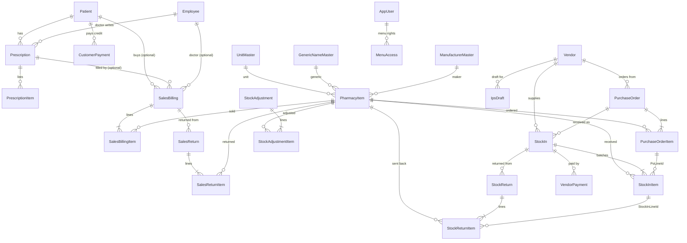

# Saravana Clinic – Pharmacy database design (proposal, 17-11-2026)

Status: **draft for approval – no code or database change made yet.**
Database: `T_EHRSaravanaClinic` on 147.93.155.21 (SQL Server). Doc code: `CLINIC_CODE=SC`.
Reference (read only): Ayush ALL IN ONE `backend/src/db/schema/pharmacy.js` – never `T_AyushNew`.

Values still to confirm are marked **❓** (see the end).

---

## 1. What exists today (map)

Saravana's pharmacy tables already match Ayush column for column (checked 17-11-2026). Saravana also keeps
older tables (Supplier, PurchaseInvoice, StockInward, PurchaseReturn, StockMovement …) whose rows still count
in stock and the Vendor Payments report.

| Table | Purpose | Key columns | Linked from | Screens |
|---|---|---|---|---|
| UnitMaster, GenericNameMaster, ManufacturerMaster, CategoryMaster, PotencyMaster | Pick-lists | Name, IsActive, (SortOrder) | PharmacyItem | Item Master |
| PharmacyItem | Item master | Name, UnitId, Pack, HSNCode, MRP, SellPrice, PurchaseRate, CGST/SGST/GSTPercent, Rack, BoxNo, Status | every line table | Item Master / List / Bulk Update, all grids |
| Vendor | Suppliers | VendorName, GSTNo, DLNo, State, Status | PurchaseOrder, StockIn, StockReturn, VendorPayment | Vendor Master / List |
| PurchaseOrder / Item | Order (no stock) | VendorId, OrderDate, TotalAmount; lines: PRate, DiscPercent, Rate, Qty, FreeQty, GST | StockIn, StockInItem.PoLineId | Purchase / Order |
| StockIn / StockInItem | Goods received (adds stock, sets sell price) | InDate, BillNo, VendorId, PurchaseOrderId; lines: BatchNo, Mfg/ExpDate, Quantity, FreeQty, Rate, MRP, SelAmount | StockReturn, VendorPayment | Stock In, Stock In List |
| StockReturn / Item | Return to vendor (reduces stock) | StockInId; lines: StockInLineId, BatchNo, Qty, Rate | – | Return |
| VendorPayment | Paying a Stock In | StockInId, Amount, PayMode, ReferenceNo | – | Vendor Payments |
| SalesBilling / Item | Counter sale (reduces stock) | TransDate, CustomerName, MobileNo, SubTotal, DiscPercent, RoundOff, TotalAmount; lines: Batch, ExpiryDate, SaleUnit, UnitQty, PackSize, Quantity (packs), Rate, DiscPercent, Amount | SalesReturn | Sales, Sales List |
| SalesReturn / Item | Customer return (adds stock back) | SalesBillingId; lines: SalesLineId, Quantity, Amount | – | Sales Return |
| StockAdjustment / Item | Opening stock and corrections | AdjDate, Remarks; lines: BatchNo, InQty/Price, OutQty/Price | – | Stock Adjustment |
| Patient, Prescription, PrescriptionItem, Employee (EmpType='Doctor') | Clinic side | Prescription.PatientId, DoctorId → Employee; PrescriptionItem.MedicineName (free text / Medication) | **not linked to pharmacy yet** | Clinic screens |

## 2. Gap list (what each wanted change needs)

| # | Change | What's missing | Size |
|---|---|---|---|
| 1 | **Pharmacy Dashboard** (from Ayush) | New API `/api/pharmacy/dashboard` and screen; reads existing tables only. Uses the item's **Re-order Level** (#5) instead of Ayush's fixed 5. | Medium |
| 2 | **Three in One (IPS)** (from Ayush) | New screen; reuses Item / Purchase Order / Stock In APIs. Stock In API: Bill No required when sent (Ayush rule). **Draft mode** needs new table `IpsDraft` + API (Ayush has only the design, not the code – built new here). | Large |
| 3 | **Scan Bill** (from Ayush) | New modal on Item Master, Purchase / Order, Stock In and Three in One; OCR runs **in the browser** (`tesseract.js`, `pdfjs-dist` – two new frontend packages). No database change. | Large |
| 4 | Expiry alert | New report (30 / 60 / 90 days, batch-wise, stock > 0); dashboard tile. Batch expiry already stored. | Small |
| 5 | Re-order level + low-stock list | Column `PharmacyItem.ReorderLevel`; field on Item Master / Bulk Update; Low Stock report; Item List red rule uses it. | Small |
| 6 | Payment modes + credit ledger | Columns on `SalesBilling` (PayMode, PaidAmount, DueAmount …); new table `CustomerPayment`; Credit Ledger screen; refund mode on Sales Return. Credit only for a registered **Patient**. | Large |
| 7 | GST stored per line, A4 GST invoice | GST columns on `SalesBillingItem` / `SalesReturnItem` (+ header sums); clinic `GSTIN`, `DrugLicenceNo`; A4 invoice print. | Medium |
| 8 | HSN-wise GST summary | New report from the stored line GST (sales − sales returns), by HSN and rate, date range; Excel export. | Medium |
| 9 | Sale linked to Patient + prescription | Columns `PatientId`, `PrescriptionId`, `DoctorId` on `SalesBilling`; Sales screen pickers; prescription lines matched to items by name. | Medium |

Already done (no gap): rack / box on item, line + bill discount, round-off, batch / FIFO-by-expiry stock, soft delete.

## 3. ER diagram



`CreatedBy` on every header holds the `AppUser.Username` (text, no FK), as today.

## 4. New and changed tables

Rules for everything below: **add only** (no drop, no rename, no type change). Every new column is `NULL` or has
a default, so old rows and old screens keep working. Old bill amounts and document numbers are never changed.

### 4.1 `PharmacyItem` – add

| Column | Type | Null | Default | Notes |
|---|---|---|---|---|
| `ReorderLevel` | DECIMAL(10,2) | NULL | – | packs; at or below → low stock. NULL = use the setting `LOW_STOCK_DEFAULT` (5). |

### 4.2 `ClinicDetails` – add (printed on the GST invoice)

| Column | Type | Null | Notes |
|---|---|---|---|
| `GSTIN` | NVARCHAR(15) | NULL | 15 characters, capitals |
| `DrugLicenceNo` | NVARCHAR(100) | NULL | DL numbers as printed (e.g. "20B-123, 21B-124") |
| `StateName` | NVARCHAR(60) | NULL | place of supply, e.g. Tamil Nadu |

### 4.3 `SalesBilling` – add

| Column | Type | Null | Default | Notes |
|---|---|---|---|---|
| `PatientId` | INT | NULL | – | FK → Patient. Required when `DueAmount > 0` (credit). |
| `PrescriptionId` | INT | NULL | – | FK → Prescription (must belong to `PatientId`). |
| `DoctorId` | INT | NULL | – | FK → Employee (EmpType 'Doctor'); filled from the prescription, can be picked. |
| `PayMode` | NVARCHAR(20) | NOT NULL | `'Cash'` | Cash, UPI, Card, Credit, Mixed ❓ |
| `PayReference` | NVARCHAR(50) | NULL | – | UPI txn / card last 4 |
| `PaidAmount` | DECIMAL(12,2) | NULL | – | paid at the counter; NULL on old bills = fully paid |
| `DueAmount` | DECIMAL(12,2) | NOT NULL | `0` | = TotalAmount − PaidAmount (credit) |
| `TaxableAmount` | DECIMAL(12,2) | NULL | – | Σ line TaxableAmount |
| `CGSTAmount`, `SGSTAmount`, `IGSTAmount` | DECIMAL(12,2) | NULL | – | Σ of the lines |

Index: `IX_SalesBilling_PatientId (PatientId) INCLUDE (TotalAmount, DueAmount, TransDate) WHERE IsActive = 1`.
Check: `CK_SalesBilling_Due CHECK (DueAmount >= 0)`.

### 4.4 `SalesBillingItem` and `SalesReturnItem` – add (same columns on both)

| Column | Type | Null | Notes |
|---|---|---|---|
| `HSNCode` | NVARCHAR(30) | NULL | copied from the item at sale time |
| `GSTPercent` | DECIMAL(5,2) | NULL | copied from the item (CGST % + SGST %) |
| `NetAmount` | DECIMAL(12,2) | NULL | line Amount less its share of the Bill Discount (GST-inclusive) |
| `TaxableAmount` | DECIMAL(12,2) | NULL | = NetAmount ÷ (1 + GST% / 100) |
| `CGSTAmount`, `SGSTAmount` | DECIMAL(12,2) | NULL | half each of NetAmount − TaxableAmount (intra-state) |
| `IGSTAmount` | DECIMAL(12,2) | NULL | 0 for counter sales (only if inter-state is needed ❓) |

### 4.5 `SalesReturn` – add

| Column | Type | Null | Default | Notes |
|---|---|---|---|---|
| `RefundMode` | NVARCHAR(20) | NOT NULL | `'Cash'` | `Cash` (money back) or `Credit` (reduces the patient's due) |
| `TaxableAmount`, `CGSTAmount`, `SGSTAmount`, `IGSTAmount` | DECIMAL(12,2) | NULL | – | Σ of the lines |

### 4.6 New `CustomerPayment` – money received against a patient's credit

| Column | Type | Null | Default | Keys / notes |
|---|---|---|---|---|
| `PaymentId` | INT IDENTITY | NOT NULL | | PK. Number `SC-CP0001` |
| `PatientId` | INT | NOT NULL | | FK → Patient |
| `PayDate` | DATE | NOT NULL | | not in the future |
| `Amount` | DECIMAL(12,2) | NOT NULL | | > 0 and ≤ the patient's balance (server checks) |
| `PayMode` | NVARCHAR(20) | NOT NULL | | Cash, UPI, Card, Bank Transfer, Cheque |
| `ReferenceNo` | NVARCHAR(50) | NULL | | required except Cash |
| `Notes` | NVARCHAR(300) | NULL | | |
| `CreatedBy` | NVARCHAR(100) | NULL | | |
| `IsActive` | BIT | NOT NULL | 1 | soft delete, Admin only |
| `CreatedAt` | DATETIME | NOT NULL | GETDATE() | |

Index: `IX_CustomerPayment_PatientId (PatientId) INCLUDE (Amount) WHERE IsActive = 1`.

**Patient balance** (worked out, never stored):
`Σ SalesBilling.DueAmount − Σ SalesReturn.TotalAmount (RefundMode = 'Credit') − Σ CustomerPayment.Amount`, active
rows only. Payments are not tied to one bill (a running ledger); the ledger screen lists bills, returns and
payments by date with a running balance.

### 4.7 New `IpsDraft` – Three in One drafts (Ayush design, docs/07)

| Column | Type | Null | Default | Notes |
|---|---|---|---|---|
| `DraftId` | INT IDENTITY | NOT NULL | | PK |
| `VendorId` | INT | NULL | | FK → Vendor |
| `BillNo` | NVARCHAR(50) | NULL | | |
| `BillDate` | DATE | NULL | | |
| `Data` | NVARCHAR(MAX) | NOT NULL | | the whole screen as JSON (`ISJSON(Data) = 1` check) |
| `LineCount` | INT | NOT NULL | 0 | |
| `NetAmount` | DECIMAL(12,2) | NOT NULL | 0 | |
| `CreatedBy` | NVARCHAR(100) | NULL | | |
| `CreatedAt`, `UpdatedAt` | DATETIME | NOT NULL | GETDATE() | |

A draft never changes items, orders, stock or prices. It is deleted (hard delete – it is only screen data) after
Save All.

## 5. How stock is worked out (unchanged)

Stock is never stored. Per batch = `ItemId` + `BatchNo`, in packs, active headers only:

```
Received = StockInItem (Quantity + FreeQty) + StockAdjustmentItem.InQty
           (+ older StockInward / PurchaseInvoiceItem rows)
Returned = StockReturnItem.Quantity + StockAdjustmentItem.OutQty (+ older PurchaseReturnItem)
Sold     = SalesBillingItem.Quantity − SalesReturnItem.Quantity
Batch stock = Received − Returned − Sold          (never below 0)
Item stock  = Σ batch stock + Σ StockMovement.QtyChange (old opening stock)
```

- Sales picks batches **earliest expiry first** (no expiry last). Expiry Report = batches with stock > 0 and
  `ExpDate ≤ today + N days` (30 / 60 / 90), expired ones on top in red.
- Because every number comes from the documents, stock can be rebuilt any time; deleting (soft) a document
  undoes its effect. Stock-changing saves keep `sp_getapplock 'pharmacy-stock'`.
- None of the new columns change this. Three in One saves through the same Item / Order / Stock In code.

## 6. How GST is stored

- Prices (MRP, Sale Price) are **GST-inclusive** (retail). On each sale line, at save time:
  1. `Amount` = UnitQty × Rate less row Disc% (as today).
  2. `NetAmount` = Amount less this line's share of the Bill Discount (same %), rounded to paise.
  3. `TaxableAmount` = round(NetAmount ÷ (1 + GSTPercent / 100), 2).
  4. `CGSTAmount` = round((NetAmount − TaxableAmount) / 2, 2); `SGSTAmount` = the rest (so the two add up exactly).
  5. `HSNCode`, `GSTPercent` copied from the item **as they are that day**.
- Round Off is not taxed and is not spread over lines.
- Header sums are saved too, so the invoice and reports read stored figures and **never recalculate old bills**.
- Sales Return lines copy the sale line's HSN / GST % and take the same proportion of its stored GST.
- Old bills (before this change) have NULL GST columns. Reports show them under **"GST not recorded"** unless
  you approve a one-time back-fill from the item's current HSN / GST % (amounts are not touched) ❓.
- Purchases already store GST on the order line (CGST / SGST %); the HSN report can add a purchase (input tax)
  section from those ❓.

## 7. Migration script (add only, safe to run twice)

Goes into `backend/src/db/initDb.js` (run with `npm run init-db`), the same way as every earlier change.

```sql
-- 4.1 Re-order level
IF COL_LENGTH('PharmacyItem','ReorderLevel') IS NULL
    ALTER TABLE PharmacyItem ADD ReorderLevel DECIMAL(10,2) NULL;

-- 4.2 Clinic GST details
IF COL_LENGTH('ClinicDetails','GSTIN') IS NULL         ALTER TABLE ClinicDetails ADD GSTIN NVARCHAR(15) NULL;
IF COL_LENGTH('ClinicDetails','DrugLicenceNo') IS NULL ALTER TABLE ClinicDetails ADD DrugLicenceNo NVARCHAR(100) NULL;
IF COL_LENGTH('ClinicDetails','StateName') IS NULL     ALTER TABLE ClinicDetails ADD StateName NVARCHAR(60) NULL;

-- 4.3 Sales header: patient / prescription / doctor, payment, GST sums
IF COL_LENGTH('SalesBilling','PatientId') IS NULL      ALTER TABLE SalesBilling ADD PatientId INT NULL;
IF COL_LENGTH('SalesBilling','PrescriptionId') IS NULL ALTER TABLE SalesBilling ADD PrescriptionId INT NULL;
IF COL_LENGTH('SalesBilling','DoctorId') IS NULL       ALTER TABLE SalesBilling ADD DoctorId INT NULL;
IF COL_LENGTH('SalesBilling','PayMode') IS NULL
    ALTER TABLE SalesBilling ADD PayMode NVARCHAR(20) NOT NULL CONSTRAINT DF_SalesBilling_PayMode DEFAULT 'Cash';
IF COL_LENGTH('SalesBilling','PayReference') IS NULL   ALTER TABLE SalesBilling ADD PayReference NVARCHAR(50) NULL;
IF COL_LENGTH('SalesBilling','PaidAmount') IS NULL     ALTER TABLE SalesBilling ADD PaidAmount DECIMAL(12,2) NULL;
IF COL_LENGTH('SalesBilling','DueAmount') IS NULL
    ALTER TABLE SalesBilling ADD DueAmount DECIMAL(12,2) NOT NULL CONSTRAINT DF_SalesBilling_DueAmount DEFAULT 0;
IF COL_LENGTH('SalesBilling','TaxableAmount') IS NULL  ALTER TABLE SalesBilling ADD TaxableAmount DECIMAL(12,2) NULL;
IF COL_LENGTH('SalesBilling','CGSTAmount') IS NULL     ALTER TABLE SalesBilling ADD CGSTAmount DECIMAL(12,2) NULL;
IF COL_LENGTH('SalesBilling','SGSTAmount') IS NULL     ALTER TABLE SalesBilling ADD SGSTAmount DECIMAL(12,2) NULL;
IF COL_LENGTH('SalesBilling','IGSTAmount') IS NULL     ALTER TABLE SalesBilling ADD IGSTAmount DECIMAL(12,2) NULL;
IF OBJECT_ID('FK_SalesBilling_Patient') IS NULL
    ALTER TABLE SalesBilling ADD CONSTRAINT FK_SalesBilling_Patient FOREIGN KEY (PatientId) REFERENCES Patient(PatientId);
IF OBJECT_ID('FK_SalesBilling_Prescription') IS NULL
    ALTER TABLE SalesBilling ADD CONSTRAINT FK_SalesBilling_Prescription FOREIGN KEY (PrescriptionId) REFERENCES Prescription(PrescriptionId);
IF OBJECT_ID('FK_SalesBilling_Doctor') IS NULL
    ALTER TABLE SalesBilling ADD CONSTRAINT FK_SalesBilling_Doctor FOREIGN KEY (DoctorId) REFERENCES Employee(EmployeeId);
IF OBJECT_ID('CK_SalesBilling_Due') IS NULL
    ALTER TABLE SalesBilling ADD CONSTRAINT CK_SalesBilling_Due CHECK (DueAmount >= 0);
IF NOT EXISTS (SELECT 1 FROM sys.indexes WHERE name = 'IX_SalesBilling_PatientId')
    CREATE INDEX IX_SalesBilling_PatientId ON SalesBilling (PatientId) INCLUDE (TotalAmount, DueAmount, TransDate) WHERE IsActive = 1;

-- 4.4 GST on sale and sales-return lines
IF COL_LENGTH('SalesBillingItem','HSNCode') IS NULL       ALTER TABLE SalesBillingItem ADD HSNCode NVARCHAR(30) NULL;
IF COL_LENGTH('SalesBillingItem','GSTPercent') IS NULL    ALTER TABLE SalesBillingItem ADD GSTPercent DECIMAL(5,2) NULL;
IF COL_LENGTH('SalesBillingItem','NetAmount') IS NULL     ALTER TABLE SalesBillingItem ADD NetAmount DECIMAL(12,2) NULL;
IF COL_LENGTH('SalesBillingItem','TaxableAmount') IS NULL ALTER TABLE SalesBillingItem ADD TaxableAmount DECIMAL(12,2) NULL;
IF COL_LENGTH('SalesBillingItem','CGSTAmount') IS NULL    ALTER TABLE SalesBillingItem ADD CGSTAmount DECIMAL(12,2) NULL;
IF COL_LENGTH('SalesBillingItem','SGSTAmount') IS NULL    ALTER TABLE SalesBillingItem ADD SGSTAmount DECIMAL(12,2) NULL;
IF COL_LENGTH('SalesBillingItem','IGSTAmount') IS NULL    ALTER TABLE SalesBillingItem ADD IGSTAmount DECIMAL(12,2) NULL;
IF COL_LENGTH('SalesReturnItem','HSNCode') IS NULL        ALTER TABLE SalesReturnItem ADD HSNCode NVARCHAR(30) NULL;
IF COL_LENGTH('SalesReturnItem','GSTPercent') IS NULL     ALTER TABLE SalesReturnItem ADD GSTPercent DECIMAL(5,2) NULL;
IF COL_LENGTH('SalesReturnItem','NetAmount') IS NULL      ALTER TABLE SalesReturnItem ADD NetAmount DECIMAL(12,2) NULL;
IF COL_LENGTH('SalesReturnItem','TaxableAmount') IS NULL  ALTER TABLE SalesReturnItem ADD TaxableAmount DECIMAL(12,2) NULL;
IF COL_LENGTH('SalesReturnItem','CGSTAmount') IS NULL     ALTER TABLE SalesReturnItem ADD CGSTAmount DECIMAL(12,2) NULL;
IF COL_LENGTH('SalesReturnItem','SGSTAmount') IS NULL     ALTER TABLE SalesReturnItem ADD SGSTAmount DECIMAL(12,2) NULL;
IF COL_LENGTH('SalesReturnItem','IGSTAmount') IS NULL     ALTER TABLE SalesReturnItem ADD IGSTAmount DECIMAL(12,2) NULL;

-- 4.5 Sales Return refund mode and GST sums
IF COL_LENGTH('SalesReturn','RefundMode') IS NULL
    ALTER TABLE SalesReturn ADD RefundMode NVARCHAR(20) NOT NULL CONSTRAINT DF_SalesReturn_RefundMode DEFAULT 'Cash';
IF COL_LENGTH('SalesReturn','TaxableAmount') IS NULL ALTER TABLE SalesReturn ADD TaxableAmount DECIMAL(12,2) NULL;
IF COL_LENGTH('SalesReturn','CGSTAmount') IS NULL    ALTER TABLE SalesReturn ADD CGSTAmount DECIMAL(12,2) NULL;
IF COL_LENGTH('SalesReturn','SGSTAmount') IS NULL    ALTER TABLE SalesReturn ADD SGSTAmount DECIMAL(12,2) NULL;
IF COL_LENGTH('SalesReturn','IGSTAmount') IS NULL    ALTER TABLE SalesReturn ADD IGSTAmount DECIMAL(12,2) NULL;

-- 4.6 Credit payments
IF OBJECT_ID('CustomerPayment', 'U') IS NULL
CREATE TABLE CustomerPayment (
    PaymentId   INT IDENTITY(1,1) PRIMARY KEY,
    PatientId   INT NOT NULL,
    PayDate     DATE NOT NULL,
    Amount      DECIMAL(12,2) NOT NULL,
    PayMode     NVARCHAR(20) NOT NULL,
    ReferenceNo NVARCHAR(50) NULL,
    Notes       NVARCHAR(300) NULL,
    CreatedBy   NVARCHAR(100) NULL,
    IsActive    BIT NOT NULL DEFAULT 1,
    CreatedAt   DATETIME NOT NULL DEFAULT GETDATE(),
    CONSTRAINT FK_CustomerPayment_Patient FOREIGN KEY (PatientId) REFERENCES Patient(PatientId),
    CONSTRAINT CK_CustomerPayment_Amount CHECK (Amount > 0)
);
IF NOT EXISTS (SELECT 1 FROM sys.indexes WHERE name = 'IX_CustomerPayment_PatientId')
    CREATE INDEX IX_CustomerPayment_PatientId ON CustomerPayment (PatientId) INCLUDE (Amount) WHERE IsActive = 1;

-- 4.7 Three in One drafts
IF OBJECT_ID('IpsDraft', 'U') IS NULL
CREATE TABLE IpsDraft (
    DraftId   INT IDENTITY(1,1) PRIMARY KEY,
    VendorId  INT NULL,
    BillNo    NVARCHAR(50) NULL,
    BillDate  DATE NULL,
    Data      NVARCHAR(MAX) NOT NULL,
    LineCount INT NOT NULL DEFAULT 0,
    NetAmount DECIMAL(12,2) NOT NULL DEFAULT 0,
    CreatedBy NVARCHAR(100) NULL,
    CreatedAt DATETIME NOT NULL DEFAULT GETDATE(),
    UpdatedAt DATETIME NOT NULL DEFAULT GETDATE(),
    CONSTRAINT FK_IpsDraft_Vendor FOREIGN KEY (VendorId) REFERENCES Vendor(VendorId),
    CONSTRAINT CK_IpsDraft_Json CHECK (ISJSON(Data) = 1)
);
```

New menu keys (MenuAccess): `pharmacy.dashboard`, `pharmacy.stock-ips`, `pharmacy.credit-ledger`,
`pharmacy.expiry-report`, `pharmacy.low-stock`, `pharmacy.gst-summary`.

## 8. To confirm (❓)

1. **GSTIN, Drug Licence No, State** of Saravana Clinic (entered once in Clinic Master – not hard-coded).
2. **Intra-state only?** Counter sales are CGST + SGST. IGST columns are added but stay 0 unless you need
   inter-state sales.
3. **Pay modes:** Cash / UPI / Card / Credit – and do you want **Mixed** (part cash, part UPI on one bill)?
4. **Credit only for registered patients** (walk-in customers must pay in full) – OK?
5. **Old bills' GST:** leave as "not recorded", or one-time back-fill from the item's current HSN / GST %?
6. **HSN report:** sales only, or also a purchase (input tax) section?
7. **Pharmacy type** (Homeopathy / Allopathy / Mixed) – affects only labels such as Potency and Schedule H.
